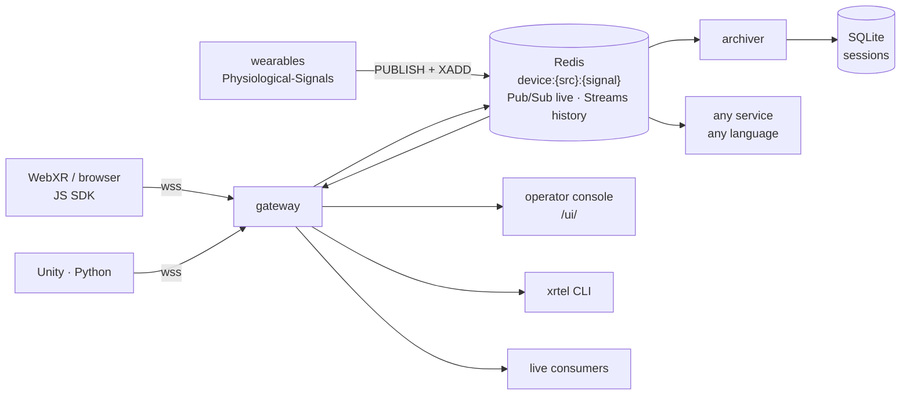

# XR-telemetry

Interoperable telemetry for extended-reality experiences: head pose and gaze
from headsets, physiological signals from wearables, and events from any
platform, published to one place, read **live** and **afterwards**, on one time
axis.

Developed in the [AMPLIFY](https://github.com/amplify-project) project.

> **Status: v0.2, working prototype.** Gateway, archiver, JavaScript SDK and
> the `xrtel` CLI run end to end against Redis; the specification is still a draft.

## The idea

XR-telemetry is a **convention over Redis**, plus a few small pieces:



- **Key space and sample format** — anything that follows it interoperates,
  whatever language or platform it runs on.
- **One time axis** — a reference clock with a measured error bound, so a
  headset and a wristband on different machines can be aligned.
- **Explicit coordinate frames** on every pose sample (`local-floor`, `room`,
  `screen`).
- **Gateway** — WebSocket front for browsers/WebXR and for deployments where
  Redis must not be exposed; tokens and sessions.
- **Archiver** — every session kept in SQLite, exported as CSV/NDJSON.
- **Operator console** — a web page served by the gateway at `/ui/`: sessions,
  marks, live devices, a top view of the room, downloads.
- **`xrtel` CLI** — the same from a terminal: start and stop a test when you choose, put markers on the
  timeline, watch live, export. See [Running a test](docs/running-a-test.md).

The AMPLIFY Physiological-Signals stack already follows the key space, so it
interoperates with no change.

## Try it

Needs Docker and Node ≥ 22.

```bash
cd deploy && cp .env.example .env && docker compose up -d --build   # Redis (:6380) + gateway (:8090) + archiver
curl localhost:8090/health
cd ../gateway && npm install && cd ..
cd ../cli && npm install && cd ..
node cli/xrtel.mjs login http://localhost:8090
node cli/xrtel.mjs start first-test
node tools/simulate.mjs --headsets 3 --physio 2 --redis redis://127.0.0.1:6380   # Ctrl+C after a while
node cli/xrtel.mjs stop
node cli/xrtel.mjs show first-test
node cli/xrtel.mjs export first-test --signal pose
```

Or do the same from the browser at <http://localhost:8090/ui/>.

Three simulated headsets publish poses and events through the gateway with the
JS SDK; two simulated wearables write straight to Redis the way
Physiological-Signals does; all of it lands in the session you started.
Live, from any language, straight from Redis:

```bash
python examples/python/consume.py --redis redis://127.0.0.1:6380                 # live
python examples/python/consume.py --redis redis://127.0.0.1:6380 --replay pose   # history
```

or over WebSocket at `ws://localhost:8090/consume` (`?session=`, `?signals=pose,event`).

**Existing Livestreamed Immersive Player**: point it at the gateway with
`?telemetry=ws://<host>:8090/ingest` — its current wire format is accepted as is
and mapped to spec `pose` samples.

**Tests**: `cd gateway && npm test` (starts a throwaway Redis in Docker).

## Layout

| Path | What |
|---|---|
| `docs/spec.md` | The specification |
| `gateway/` | WebSocket ↔ Redis gateway (Node): tokens, sessions, reference clock, snapshot, presence, operator API — and the archiver (`bin/xrtel-archiver.js`), same image |
| `gateway/ui/` | Operator console (one HTML file, served at `/ui/`) |
| `cli/` | `xrtel`: start/stop/mark, watch, sessions, export |
| `sdk/js/` | Browser / WebXR / Node SDK: `pose()`, `event()`, `send()` |
| `tools/simulate.mjs` | Fake headsets (via gateway) and wearables (direct to Redis) |
| `tools/bridge.mjs` | A local Redis (venue LAN) → a remote gateway, no producer changes |
| `examples/python/` | Reading live and history straight from Redis |
| `deploy/` | Docker Compose: Redis + gateway + archiver |

## Documents

- [`docs/partners.md`](docs/partners.md) — what partner projects change (nothing in code) and the Physiological-Signals bridge
- [`docs/running-a-test.md`](docs/running-a-test.md) — from headsets on to a CSV
- [`docs/architecture.md`](docs/architecture.md) — how it works, with diagrams
- [`docs/deployment.md`](docs/deployment.md) — laptop, lab LAN, cloud (EC2 + CloudFront), troubleshooting, retention
- [`docs/spec.md`](docs/spec.md) — the specification (draft v0.1)

## Roadmap

1. Specification (this draft) — review with the projects that will use it
2. ✅ Gateway (from the Livestreamed Immersive Player relay) + Redis backend — prototype
3. ✅ JavaScript/WebXR SDK — prototype
4. ✅ Archiver (SQLite, CSV/NDJSON export) and `xrtel` CLI — prototype; PostgreSQL/TimescaleDB and Parquet next
5. Python and Unity SDKs
6. Evaluation: end-to-end latency, clock error, throughput, loss under disconnection

## License

[Apache-2.0](LICENSE).
