# Architecture

How the pieces fit, what happens to one sample from a headset to a CSV, and
why each piece exists. The normative rules are in the [specification](spec.md);
this page explains the reference implementation.

## The pieces

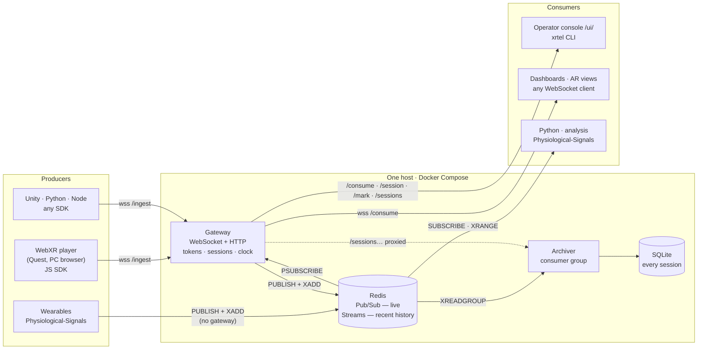

| Piece | Why it exists |
|---|---|
| **Redis** | The meeting point. Physiological-Signals already publishes there, so anything that follows the key space ([spec §3](spec.md#3-key-space)) interoperates with it without code changes. Pub/Sub fans samples out live; Streams keep the recent past. |
| **Gateway** | Browsers and WebXR cannot open a Redis connection, and Redis must never face the Internet. The gateway is the only public door: it checks tokens, stamps every sample on one reference clock, and exposes the operator API. |
| **Archiver** | Redis streams are capped (~20 000 samples, about 16 minutes of pose at 20 Hz). The archiver is what makes a test durable. |
| **Console and CLI** | So that running a test means typing a name, not touching Redis or WebSockets. |

The gateway and the archiver are the same Docker image started with two
commands (`bin/xrtel-gateway.js`, `bin/xrtel-archiver.js`).

## One sample, end to end

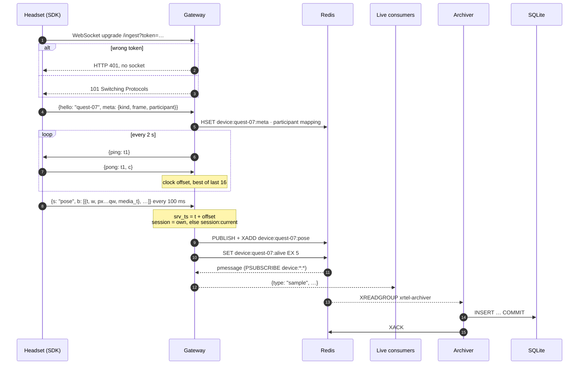

Consumers are fed **from Redis, not from the producer**. A headset behind the
gateway and a wristband writing to Redis directly therefore reach every
consumer the same way, including those of another gateway on the same Redis.

## Time

Each machine has its own clock, and a headset's wall clock can be seconds off.
Every sample therefore carries up to three times:

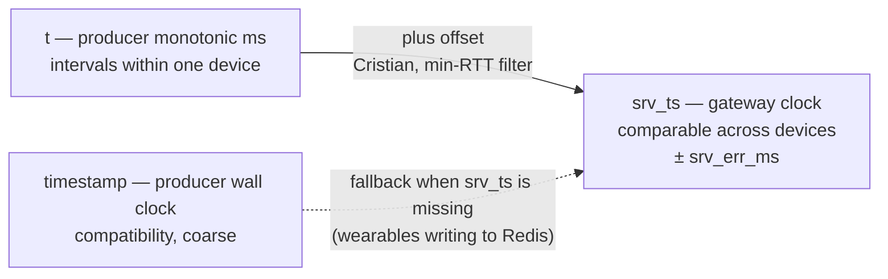

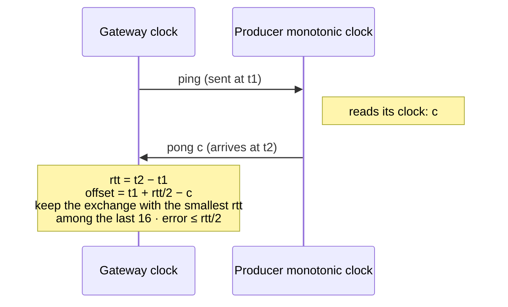

A fast exchange had little time to be asymmetric, so the smallest round trip
gives the tightest bound; the sliding window follows oscillator drift. The
end-to-end test checks that a producer whose clock is five hours off lands on
the right `srv_ts`.

### Wearables writing to Redis directly

They carry only `timestamp`, their machine's wall clock, which nobody keeps in
step with the gateway. A PC clock off by seconds is common. Two remedies:

- **The bridge** (`tools/bridge.mjs`, [partners](partners.md#physiological-signals-bridge))
  turns them into gateway producers. Every sample gets `srv_ts`.
- **The clock check**, done by the archiver for every device without `srv_ts`.
  It needs nothing from the producer.

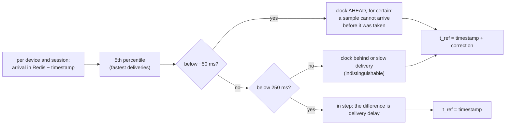

Arrival is the Redis server's clock, which is the reference clock when Redis
and the gateway run on one host, as in the reference deployment. The check is
shown per session in the console and in `xrtel show`, with a status of `ok`,
`check` or `off`. The export's `t_ref` column applies the correction, so
samples from different machines interleave correctly.

The correction is good to about the fastest delivery from the device to Redis:
tens of milliseconds on a LAN. That is far below the physiological latencies it
is used to align: EDA responds 1–3 s after a stimulus.

## Sessions

A session is one test. **Whoever runs the test names it, at the moment they
choose**, from the console or with `xrtel start`. Headsets do not need a new
URL per test.

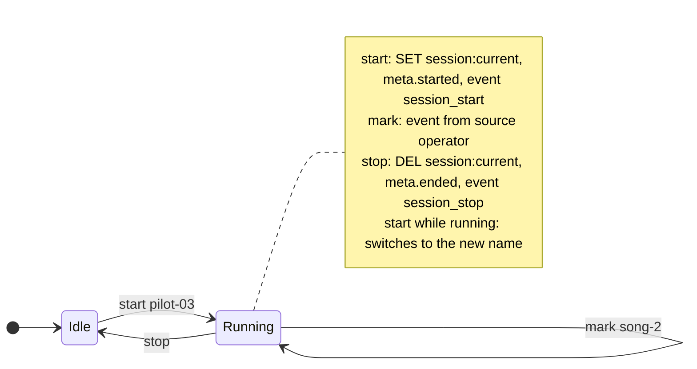

Which session a sample is filed under:

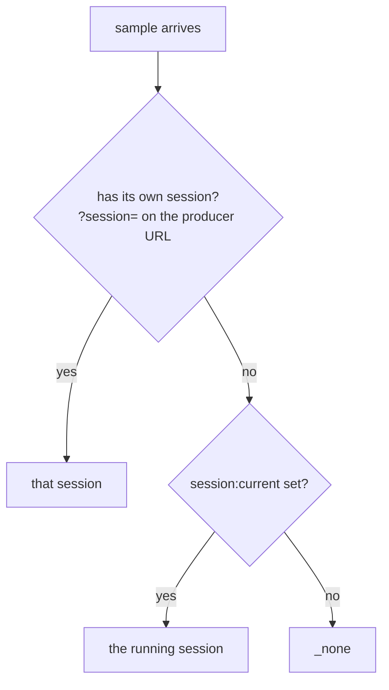

A producer that names its own session keeps it, so a fixed installation and an
experiment can share one deployment. The gateway applies the rule for its
producers when it writes. The archiver applies it again when it reads, for
producers that write to Redis directly.

Physiological-Signals' engagement PC has its own session name,
`engagement:session_id`. It is read as a further fallback after
`session:current` and never written ([partners](partners.md#session-names-engagementsession_id)).

Session boundaries and marks are ordinary `event` samples from a source called
`operator`. They are on the same timeline as everything else, live and in the
export.

## Archive

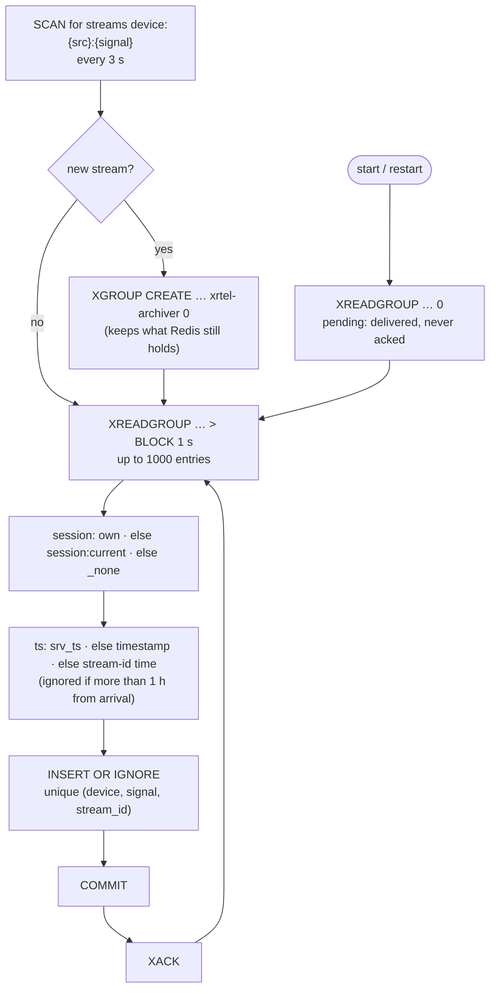

- **Nothing is lost while it runs.** A sample is acknowledged only after the
  transaction commits. After a crash, the pending entries are read again first,
  and the unique key makes a second insert harmless.
- **It catches up after downtime**, as long as it was down for less than the
  Redis window (~16 minutes at 20 Hz per stream).

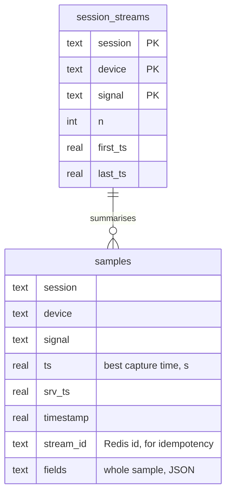

One long table keeps every signal's own fields without a schema per signal. The
`session_streams` summary makes the session list and rates instant even with
millions of rows.

**Retention.** Every hour the archiver deletes whole sessions older than
`ARCHIVE_RETENTION_DAYS` (30 by default), and, if `ARCHIVE_MAX_MB` is set, the
oldest finished sessions while the file is over it. It then runs `VACUUM`,
because SQLite reuses freed pages but does not return them to the disk. See
[Deployment → Data, disk and backups](deployment.md#data-disk-and-backups).

## Gateway HTTP

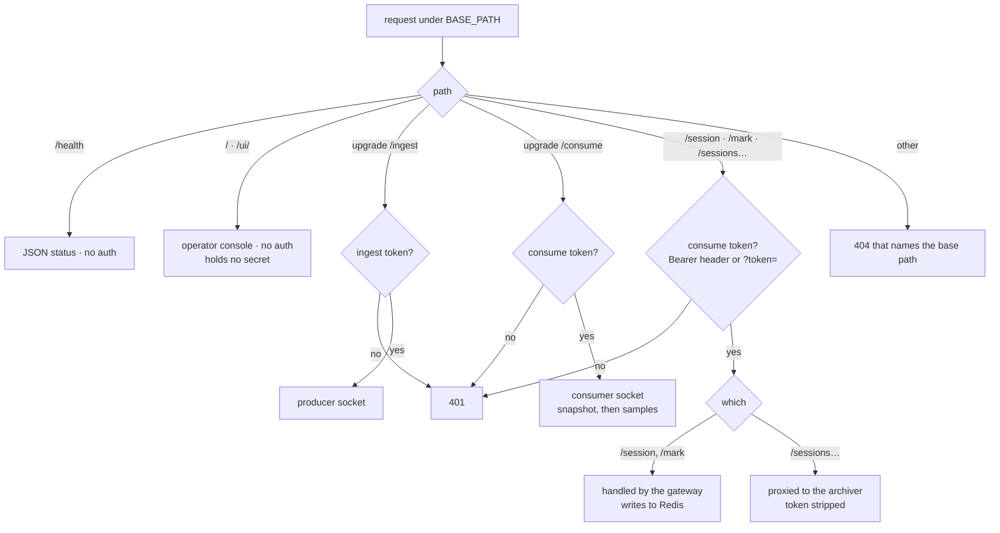

**Two tokens, two trust levels.** The ingest token ships inside the web player,
so anyone can read it. It only lets a client publish, and it deters bots. The
consume token is the real secret: it reads everything, starts and stops
sessions, and downloads data.

## Redis key space

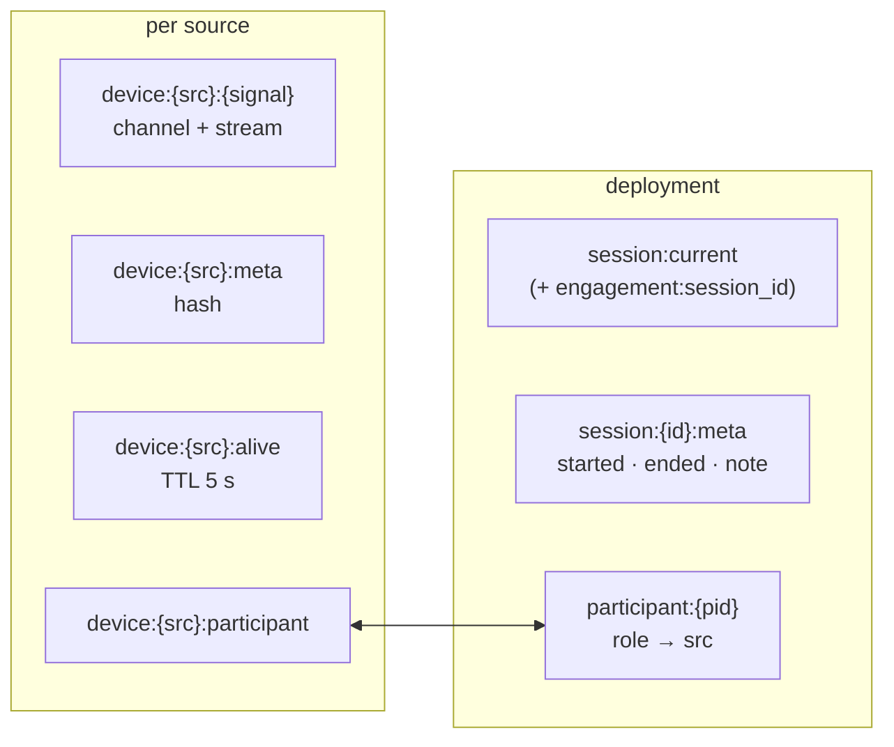

An optional namespace prefix (`amplify:device:…`) isolates several projects on
one Redis.
