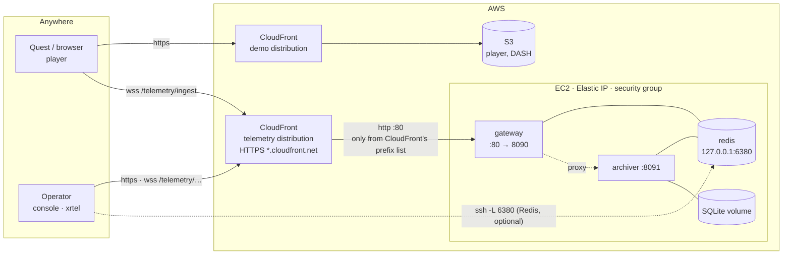
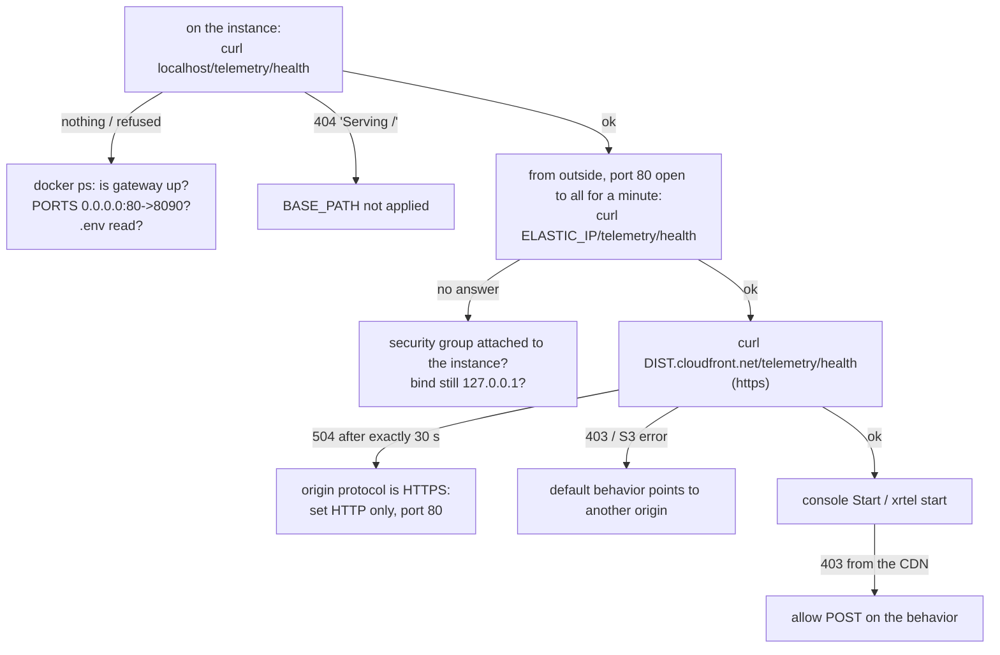
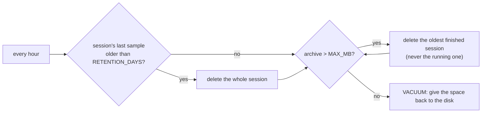

# Deployment

Three ways to run it, from a laptop to the Internet, and the traps met on the
way.

| Where | Who reaches it | TLS |
|---|---|---|
| [Laptop](#laptop) | this machine | none |
| [Lab LAN](#lab-lan) | headsets on the same network | the gateway's own cert (`TLS_KEY`/`TLS_CERT`) |
| [Cloud](#cloud-ec2-behind-cloudfront) | anyone with the URL | CloudFront |

## Laptop

```bash
cd deploy && cp .env.example .env && docker compose up -d --build
curl localhost:8090/health                  # then http://localhost:8090/ui/
```

Redis is published on `127.0.0.1:6380` (6379 is often taken), and the gateway
on `127.0.0.1:8090`. The archiver has no published port: only the gateway talks
to it.

## Lab LAN

A headset loads the player over HTTPS, so it can only open `wss://`. On a LAN
without a public name, give the gateway the same self-signed certificate the
headset already accepted for the player:

```
GATEWAY_BIND=0.0.0.0
TLS_KEY=/certs/key.pem
TLS_CERT=/certs/cert.pem
```

## Cloud: EC2 behind CloudFront



**Why CloudFront.** The player is served over HTTPS, so its telemetry must be
`wss://`, which needs a certificate. An EC2 instance without a domain has none,
and Let's Encrypt does not issue certificates for `*.compute.amazonaws.com`
names. CloudFront terminates TLS on its own `*.cloudfront.net` name, and the
security group lets only CloudFront reach the instance.

**Without CloudFront.** With a domain of your own pointed at the Elastic IP, run
Caddy on the instance (it obtains the certificate itself) or use an existing
nginx. See `telemetry/deploy/` in the Livestreamed Immersive Player for both.
That is fewer moving parts, and none of the CloudFront traps below.

A **separate distribution** keeps the telemetry away from an existing one that
serves other content. Sharing one is also possible, with a behavior
`/telemetry/*` pointing to the EC2 origin.

### 1. Instance

Ubuntu, Docker:

```bash
sudo apt update && sudo apt install -y docker.io docker-compose-v2 git
git clone https://github.com/amplify-project/XR-telemetry.git && cd XR-telemetry/deploy
cat > .env <<EOF
REDIS_PORT=6380
GATEWAY_BIND=0.0.0.0
GATEWAY_PORT=80
BASE_PATH=/telemetry
INGEST_TOKEN=$(openssl rand -hex 24)
CONSUME_TOKEN=$(openssl rand -hex 24)
ARCHIVE_RETENTION_DAYS=30
ARCHIVE_MAX_MB=4000
EOF
sudo docker compose up -d --build
sudo docker ps --format '{{.Names}}  {{.Ports}}'     # gateway: 0.0.0.0:80->8090/tcp
curl -s localhost/telemetry/health; echo              # "ok":true, auth ingest/consume true, archive true
```

**Elastic IP.** The instance's public DNS name (`ec2-1-2-3-4…`) is derived from
its IP, and a stop/start changes the IP. Allocate an Elastic IP and associate
it, then use the DNS name that comes from it.

### 2. Security group

| Type | Port | Source |
|---|---|---|
| HTTP | 80 | prefix list `com.amazonaws.global.cloudfront.origin-facing` |
| SSH | 22 | your IP |

### 3. CloudFront distribution

| Setting | Value |
|---|---|
| Origin type | **Other** (custom origin), not S3, not EC2/VPC origin |
| Origin domain | the instance's public DNS name |
| Origin protocol | **HTTP only**, port 80 |
| Origin path | empty |
| Viewer protocol | Redirect HTTP to HTTPS |
| Allowed methods | **GET, HEAD, OPTIONS, PUT, POST, PATCH, DELETE** |
| Cache policy | **CachingDisabled** |
| Origin request policy | **AllViewer** (forwards the WebSocket upgrade headers and the query string) |
| WAF | not needed |
| Origin mutual TLS | off (the origin is plain HTTP) |

`/telemetry` is not configured anywhere in CloudFront: the path is forwarded as
is, and the gateway's `BASE_PATH` serves it.

### 4. Check, then use

```bash
curl https://<dist>.cloudfront.net/telemetry/health
```

- Player: `wss://<dist>.cloudfront.net/telemetry/ingest?token=<INGEST_TOKEN>`
- Console: `https://<dist>.cloudfront.net/telemetry/ui/`
- CLI: `xrtel login https://<dist>.cloudfront.net/telemetry <CONSUME_TOKEN>`

Update later with:

```bash
cd ~/XR-telemetry && git pull && cd deploy && sudo docker compose up -d --build
```

## When it does not work

Work from the inside out. If the instance answers itself, check the instance
from outside, and only then CloudFront.



| Symptom | Cause | Fix |
|---|---|---|
| `curl -s …/telemetry/health` prints nothing | a 404: `BASE_PATH` empty, so it serves at `/` (curl `-s` hides the status) | `curl -i`; set `BASE_PATH=/telemetry` or use `/health` |
| `BASE_PATH` has the value `# /telemetry behind…` | inline comment after an empty value in `.env`: Compose reads it as the value | comments on their own lines (current `.env.example`) |
| `docker ps` shows `127.0.0.1:80->8090` | `GATEWAY_BIND` still `127.0.0.1` | `GATEWAY_BIND=0.0.0.0`, then `docker compose up -d --force-recreate gateway` |
| CloudFront 504 after exactly 30 s | origin protocol HTTPS: it dials 443 three times with a 10 s timeout | origin **HTTP only**, port 80. The form showing "HTTPS port 443" is the giveaway. |
| 403 from CloudFront on a script, not in the browser | the distribution's managed rules refuse requests **without a User-Agent** | send one (`xrtel` and the console do; Node's built-in WebSocket sends `node`) |
| 403 "from the CDN" on Start/Stop/Mark | behavior allows only GET, HEAD | allow all methods |
| "You cannot specify a prefix list for an existing IPv4 CIDR rule" | AWS will not convert a rule | delete the rule, add a new one with the prefix list |
| Saving the prefix list rule fails on a quota | the CloudFront list counts as ~55 rules (default limit 60) | a separate security group for it, or raise the quota |
| `Connection reset` from an office network | corporate proxies cut plain HTTP to bare IPs | test from the instance, or through CloudFront |

## Data, disk and backups

**How much.** About 500 bytes per sample in the archive. One headset at 20 Hz
is ~72 000 samples, **~36 MB per hour**. A wearable at 1 Hz is negligible.
Four headsets, three hours of tests a day, twenty days a month come to about
**8.6 GB a month**, more than a default 8 GB EC2 disk.

**Retention**, applied by the archiver every hour, no cron needed:

| Setting | Default | Effect |
|---|---|---|
| `ARCHIVE_RETENTION_DAYS` | 30 | a session is deleted this many days after its last sample; `0` keeps everything |
| `ARCHIVE_MAX_MB` | 0 (off) | while the archive is bigger, the oldest finished sessions are deleted first |



Whole sessions are deleted, never half of one, and never the session that is
running. Samples outside any session (`_none`) are trimmed by age. The console
and `xrtel sessions` show the date each session will be deleted: export what
must be kept.

Set `ARCHIVE_MAX_MB` to leave room for the system and Redis, e.g. `4000` on an
8 GB disk, or grow the EBS volume. Check the disk with `df -h /` and the
archive in the console header.

- Samples: SQLite in the `archive_data` volume. Back it up with
  `docker compose cp archiver:/data/xrtel.sqlite ./xrtel-$(date +%F).sqlite`.
- Redis: `redis_data` volume, append-only. Only the recent window matters
  there; the archive is the record.
- Pose, gaze and physiology tied to a person are personal data (health-related,
  for physiology). Use pseudonymous ids, keep the mapping to people outside
  XR-telemetry, and host in the EU (the reference deployment runs in eu-west-2,
  London. That is not in the EU since Brexit, but the UK has an EU adequacy
  decision; check with your data protection officer).
