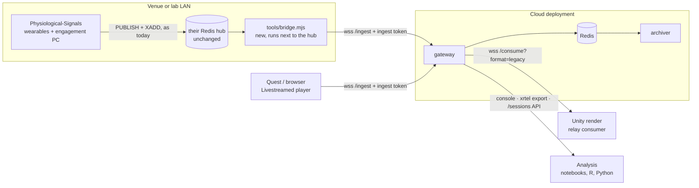

# For partner projects: what changes

Short answer: **no code changes** for any existing AMPLIFY component. What
changes is where things point, and which token each one carries.



| Partner / component | Code change | What to do |
|---|---|---|
| **Livestreamed Immersive Player** (Quest, browsers) | none | Publish it with the gateway's ingest URL and token (`TELEMETRY_URL` / `TELEMETRY_TOKEN` in `deploy-demo.sh`). Its own wire format is accepted as is. |
| **Physiological-Signals**, on its LAN | none | Keep publishing to the local hub. To get the data into a cloud deployment, run the [bridge](#physiological-signals-bridge) next to the hub. |
| **Physiological-Signals**, sharing the gateway's Redis | none | Point it at that Redis. Its key space already conforms. |
| **Consumers of the old relay** (Unity render, scripts reading `/consume`) | none | Point them at `wss://<host>/telemetry/consume?format=legacy&token=<CONSUME_TOKEN>`: same `snapshot` / `update` / `leave` messages, same field names. |
| **New consumers** | — | Spec format (`/consume`, one `sample` per message, flat fields), the console, `xrtel export`, or Redis directly. |
| **Analysis** | — | CSV/NDJSON per session from the console or `xrtel export`. See [Running a test](running-a-test.md). |
| **New producers** (Unity, Python, other headsets) | write to the gateway or to Redis | [Spec §8](spec.md#8-gateway-websocket) (WebSocket) or §3–§4 (Redis). |

## Physiological-Signals bridge

The wearables and the engagement PC talk to a Redis hub on the venue LAN, found
by mDNS. That stays exactly as it is. The cloud Redis is not reachable from
outside, and must not be.

The bridge reads the hub and forwards every sample to the cloud gateway over
WebSocket with the ingest token, one producer per wearable:

```bash
git clone https://github.com/amplify-project/XR-telemetry.git
cd XR-telemetry/gateway && npm install && cd ..
node tools/bridge.mjs --redis redis://<hub>:6379 \
     --url wss://<host>/telemetry/ingest --token <INGEST_TOKEN>
# optional: --signals physio_metrics,engagement,valence_cont,arousal_cont
```

What the bridge adds:

- **A reference clock** for the wearables. `srv_ts` is the moment the bridge
  read the sample, on the gateway's clock. The wearable's own `timestamp` is
  kept as is. Today they have no common clock with the headsets.
- **Registry and identity.** `device:{serial}:meta` and the participant mapping
  are carried over.
- **Sessions.** Wearable samples land in the session the operator started,
  next to the headsets.

It does not forward samples that already went through a gateway (they carry
`srv_ts`), so it cannot loop. Headsets on the LAN should use the gateway
directly anyway.

Running it on the engagement PC or the hub machine is enough: it only needs to
reach the hub and the Internet. If the Internet drops, each wearable keeps up
to 2000 samples queued and sends them on reconnect (about 30 minutes at 1 Hz).

## Session names: `engagement:session_id`

The engagement PC sets `engagement:session_id` to its recording folder, and the
wearable writers stamp it into their CSVs as a join key. XR-telemetry
**reads** it and **never writes it**:

- While the operator runs a session (`xrtel start`, console), that name wins.
- Otherwise samples without a session of their own follow
  `engagement:session_id`. A concert started on the engagement PC is then
  archived under the same folder name as its CSVs.
- The console and `xrtel status` show which of the two is in effect.

## Through CloudFront: send a User-Agent

The reference cloud deployment sits behind CloudFront, whose default protection
refuses requests without a `User-Agent` header (HTTP 403). Browsers, the Quest,
`xrtel`, the bridge and Node's built-in WebSocket send one. Some WebSocket
clients do not, for example .NET's `ClientWebSocket` used by Unity libraries:

```csharp
var ws = new ClientWebSocket();
ws.Options.SetRequestHeader("User-Agent", "amplify-unity/1.0");
```

A 403 that the gateway did not produce (`X-Cache: Error from cloudfront`) is
usually this.

## Tokens

| Token | Who gets it | What it allows |
|---|---|---|
| ingest | every producer: the web player (where anyone can read it), the bridge, Unity producers | publish samples |
| consume | operators, consumers, analysts | read live, start/stop sessions, marks, download |

Share the consume token like a password, never in client code.
